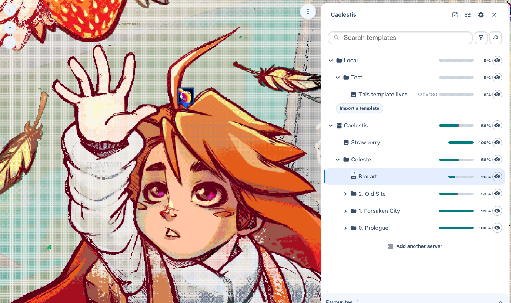

Caelestis adds image templates and painting tools to [Wplace](https://wplace.live). Import your artwork, place it on the map, and adjust the overlay to see where each colour belongs.

You can use it on your own without a server. A server lets a group share templates, track progress, and see where others are working. The web dashboard shows those templates and their history outside Wplace.

## Start painting

[Install the userscript](Install-the-userscript), then follow [Getting started](Getting-started) to place your first template.

| I want to… | Read |
| --- | --- |
| Import, move, or organise artwork | [Templates](Templates) |
| Change pixel styles, outlines, or markers | [Overlay and painting](Overlay-and-painting) |
| Join a group's server | [Connect to a server](Connect-to-a-server) |
| Track progress or paint with others | [Progress and collaboration](Progress-and-collaboration) |
| Change sharing settings or keyboard shortcuts | [Settings and shortcuts](Settings-and-shortcuts) |
| View templates and timelapses in a browser | [Dashboard](Dashboard) |

## Run a server

The backend stores shared artwork and progress. The frontend serves the dashboard. You can run both with [Docker](Run-with-Docker) or on [Cloudflare](Deploy-on-Cloudflare).

[Self-hosting](Self-hosting) compares the deployment options. The Docker guides cover SQLite, PostgreSQL, MariaDB, CNPG, and S3 storage separately.

## Project links

- [GitHub releases](https://github.com/mia-cx/Caelestis/releases)
- [Official dashboard](https://caelest.is)
- [The Quilt Discord](https://discord.gg/thequilt)
- [Report a bug](https://github.com/mia-cx/Caelestis/issues/new/choose)
- [Contribute](Contributing)
